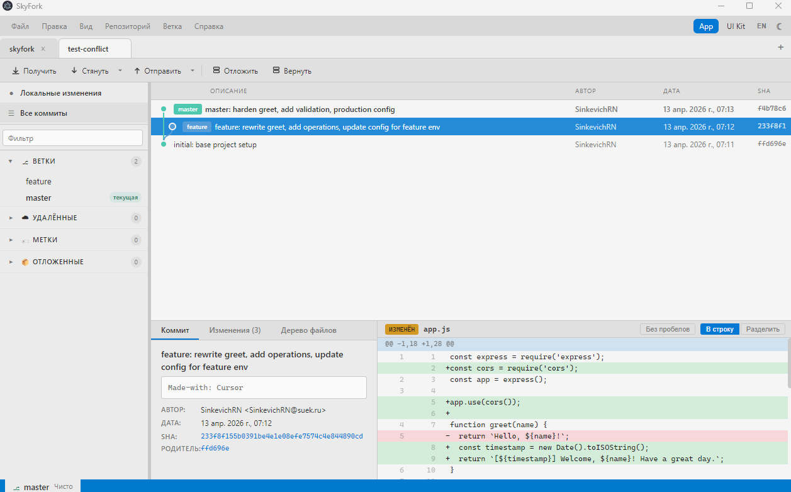

# GitBor

> English version: [docs/en/README.md](docs/en/README.md)

Бесплатный кроссплатформенный десктопный Git-клиент на Electron для Windows, macOS и Linux. Альтернатива Fork, GitKraken и SourceTree. Исходники открыты под лицензией MIT.

- Сайт: [gitbor.ru](https://gitbor.ru/)
- Документация: [gitbor.ru/docs](https://gitbor.ru/docs/) (папка [`docs/`](docs/) этого репозитория)
- Сборки и обновления: [GitHub Releases](https://github.com/RuslanSinkevich/gitbor/releases)
- Ошибки и предложения: [GitHub Issues](https://github.com/RuslanSinkevich/gitbor/issues)



---

## Быстрый старт (разработка)

```bash
npm install
npm install --prefix src/renderer
npm run dev
```

`npm run dev` через `concurrently` запускает Vite (renderer на порту 5188) и Electron (main process). Нужны Node.js 22+, npm 10+ и `git` в `PATH`.

```bash
npm run build          # renderer + main
npm start              # запуск собранного приложения
npm test               # все юнит-тесты (Vitest)
npm run lint           # ESLint
npm run e2e            # Playwright E2E (Windows)
npm run docs:counts    # обновить счётчики тестов в документации
```

Установщики: `npm run dist:win` / `dist:mac` / `dist:linux` (и варианты `:no-ai`). Релизы для всех ОС собирает GitHub Actions по тегу `vX.Y.Z` — см. [Сборка и релизы](docs/BUILD.md).

---

## Стек

| Компонент | Технология |
|-----------|-----------|
| Desktop runtime | Electron 40 |
| UI | React 18, TypeScript 5.9, Vite 6 |
| Стили | CSS Modules, CSS-переменные `--sg-*` |
| Наблюдение за файлами | chokidar 4 |
| Обновления | electron-updater 6 (GitHub Releases), electron-builder 26 |
| Тесты | Vitest 4 (<!-- TESTS_COUNT -->1116<!-- /TESTS_COUNT --> тестов в <!-- TESTS_FILES -->95<!-- /TESTS_FILES --> файлах), Playwright 1.59 (E2E, Windows) |
| Качество | ESLint 10 (flat config), Prettier, husky 9 + lint-staged 17 |
| CI | GitHub Actions: `ci.yml`, `pr.yml`, `release.yml`, `release-pack.yml` |
| Git | Системный git из `PATH` (`execFile('git', …)` в `GitExecutor`) |

---

## Архитектура

Четыре слоя, зависимости идут только вниз:

```
Renderer (React)  →  Preload (contextBridge)  →  Main (Node.js)  →  системный git
```

```
App.tsx → api.invoke() → preload (ipcRenderer) → MessageBridge (ipcMain)
  → CommandHandler → GitExecutor → git
```

Каждое открытое репо — независимый набор сервисов (`GitExecutor`, `OperationQueue`, `SafetyNet`): долгий `git pull` в одной вкладке не блокирует другие. Подробно — [Архитектура](docs/architecture.md).

---

## Структура проекта

```
gitbor/
├── src/
│   ├── core/              # Main process: вся работа с git
│   │   ├── bridge/        # IPC: MessageBridge + хендлеры в ipc/handlers*.ts
│   │   ├── commands/      # CommandHandler, readCommands, writeCommands, ConflictManager
│   │   ├── git/           # GitExecutor, парсеры, менеджеры (rebase, bisect, hooks, LFS, worktrees), gitDir, stashRef
│   │   ├── safety/        # OperationQueue, SafetyNet, PreflightChecks, OperationJournal, RecoveryManager
│   │   ├── state/         # StateManager, RepoSlicesStore, RepoStateRefresher, FileWatcher, кэши
│   │   ├── services/      # RepoServicesRegistry — сервисы на каждое репо
│   │   ├── ai/            # AI-провайдеры, промпты, хранилище настроек
│   │   ├── activity/      # Журнал git-активности
│   │   ├── workers/       # WorkerPool для тяжёлых парсеров
│   │   ├── ssh/           # SSH-ключи
│   │   └── utils/         # Logger, AppError, pathSecurity, textEncoding, semver
│   ├── main/              # Точка входа Electron, AppUpdater, updateFlavor, releaseNotes
│   ├── preload/           # contextBridge → window.gitBorAPI
│   └── renderer/src/      # React UI
│       ├── features/      # graph, sidebar, changes, diff, merge, stash, rebase, … (по папке на фичу)
│       ├── hooks/         # useAppState, useGraphFilter, useOperationToasts, …
│       ├── ui/            # UI-kit: SgDialog, SgContextMenu, SgToast, …
│       └── i18n/          # ru / en
├── tests/                 # Vitest (юнит + интеграционные на реальном git)
├── tests-e2e/             # Playwright E2E
├── docs/                  # Документация (en — в docs/en)
├── build/                 # Ресурсы сборки, release-notes.md
└── scripts/               # Иконки, флаги сборки, счётчики тестов
```

---

## Возможности

- **Граф коммитов** — виртуализированный, цвета веток, поиск (Ctrl+F), аватары авторов, приглушённые remote-only коммиты; сам обновляется после коммитов из терминала, в том числе в ветки вида `feature/имя/задача`
- **Фильтр по ветке** — «Только свои» коммиты (первый родитель) или «Вся история»; скрытие и закрепление веток
- **Сравнение** — двух коммитов, коммита с рабочей копией и двух веток в обе стороны («что принесёт в текущую» и «как в pull request»)
- **Короткие контекстные меню** ветки и коммита; «В каких ветках есть коммит», «Открыть в Azure DevOps / GitHub / GitLab», ссылка на pull request из merge-коммита
- **Локальные изменения** — дерево файлов, stage / unstage / discard по файлу, папке, блоку и строке
- **Diff** — inline / split, без пробелов, Markdown-просмотр, правильная кириллица в файлах CP1251 / CP866
- **Stash** — с новыми файлами, понятное сообщение, если откладывать нечего
- **Merge-конфликты** — двухколоночный редактор, предсказание конфликтов
- **Интерактивный rebase**, cherry-pick (в том числе несколько коммитов), revert, reset
- **История файла, blame, reflog, bisect, hooks, worktrees, LFS, .gitignore, подмодули**
- **Вкладки репозиториев** — независимые движки на каждое репо, восстановление сессии
- **AI-помощники** — сообщение коммита, объяснение коммита / reflog / конфликта, имя stash, смысловой поиск; локальные, корпоративные и облачные провайдеры (есть сборка No AI без этих функций)
- **Защита данных** — auto-stash, журнал операций, восстановление после сбоя, понятные действия при ошибках git
- **Автообновление** с GitHub Releases, список «что нового» прямо в окне обновления
- **Интерфейс** — русский и английский, тёмная и светлая темы

Полный список — [Возможности](docs/features.md).

---

## Документация

| Документ | О чём |
|----------|-------|
| [Начало работы](docs/getting-started.md) | Установка, рабочий процесс, как добавить команду |
| [Архитектура](docs/architecture.md) | Слои, поток данных, модули core и renderer |
| [Возможности](docs/features.md) | Что умеет GitBor |
| [Безопасность и ошибки](docs/safety-error-handling.md) | Классы ошибок git, SafetyDialog, preflight, восстановление |
| [Тестирование](docs/testing.md) | Vitest, Playwright, как писать тесты |
| [Участие в разработке](docs/contributing.md) | Стиль кода, коммиты, чек-лист PR |
| [Сборка и релизы](docs/BUILD.md) | Установщики, GitHub Releases, автообновление, данные пользователя |
| [Кроссплатформенность](docs/cross-platform-checklist.md) | Открытые задачи по macOS / Linux / Windows |

---

## Статус

Версия 0.1.23. <!-- TESTS_COUNT -->1116<!-- /TESTS_COUNT --> юнит-тестов в <!-- TESTS_FILES -->95<!-- /TESTS_FILES --> файлах плюс Playwright E2E на Windows. Установщики не подписаны: Windows покажет SmartScreen, macOS — предупреждение Gatekeeper.

## Лицензия

[MIT](LICENSE)
