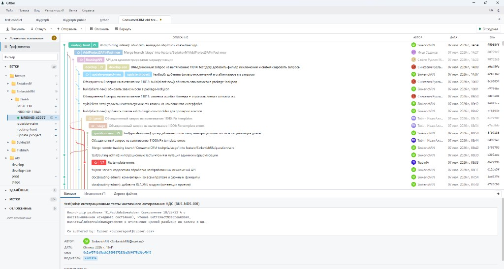
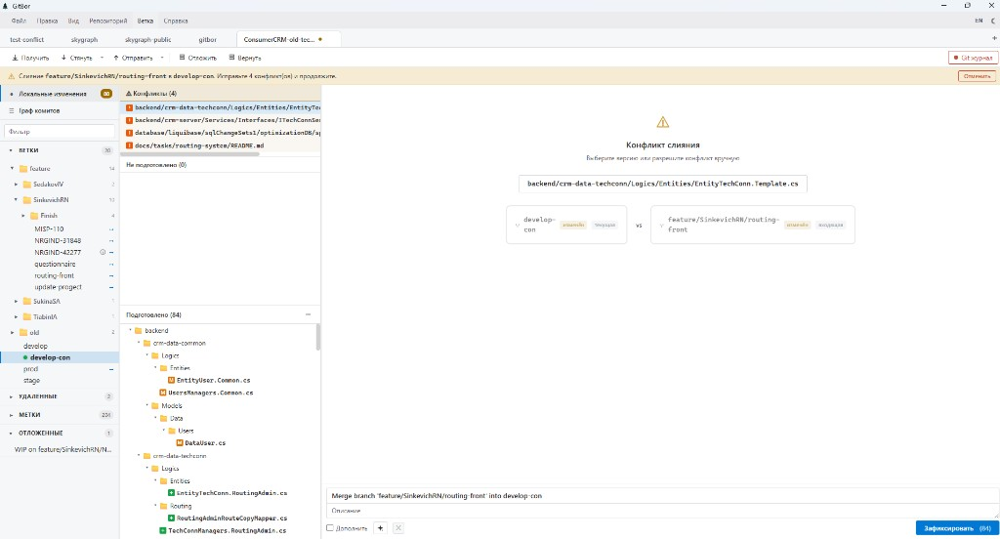

# Визуальная полировка (visual polish)

Отдельная задача по красоте и эргономике интерфейса. Цель — не редизайн, а
аккуратная доводка: цвет, размер, ширина, отступы, тени. Все правки —
токен-ориентированы (через переменные `--sg-*`), чтобы обе темы (dark/light)
менялись согласованно.

## Как было (скриншоты до правок)

Основной вид — граф коммитов + панель деталей:



Экран разрешения конфликтов:



## Что изменено

### 1. Токены дизайна (`styles/theme.css`)

- **Добавлен `--sg-radius-lg: 6px`** — единый крупный радиус для «поднятых»
  поверхностей (диалоги, оверлеи).
- **Тени переведены на слоистую модель.** Раньше — одиночная резкая тень
  (`0 8px 24px rgba(0,0,0,0.3)`). Стало — контактная + рассеянная в одном
  токене:

```css
--sg-shadow-sm: 0 1px 2px rgba(0,0,0,0.10), 0 1px 3px rgba(0,0,0,0.08);
--sg-shadow-md: 0 2px 4px rgba(0,0,0,0.12), 0 6px 16px rgba(0,0,0,0.18);
--sg-shadow-lg: 0 4px 8px rgba(0,0,0,0.14), 0 16px 40px rgba(0,0,0,0.30);
```

Плоскости читаются как приподнятые, край мягче. Для светлой темы —
свой, более лёгкий набор.

### 2. Граф коммитов (`features/graph/CommitGraph.module.css`)

- **Фикс hover-строки.** Было `background: rgba(255,255,255,0.04)` — белый
  оверлей, который в светлой теме практически невидим. Стало
  `var(--sg-surface-hover)` — работает в обеих темах.
- **Шапка таблицы читабельнее:** размер шрифта `10px → 11px`,
  трекинг `0.5px → 0.6px`.

### 3. Вкладки репозиториев (`features/repo-tabs/RepoTabs.module.css`)

- **Акцент активной вкладки сверху** — тонкая полоса `--sg-primary` через
  `inset box-shadow` (не занимает высоту, содержимое не смещается). Активная
  вкладка теперь явно «подсвечена», как в редакторах.

### 4. Скроллбар (`styles/global.css`)

- Ширина `8px → 10px`, но за счёт прозрачной рамки + `background-clip:
  padding-box` сам ползунок визуально тоньше и с «воздухом» по краям.
- Добавлен плавный переход цвета и обработка `scrollbar-corner`.

### 5. UI-kit (`styles/ui-kit.css`) и точечные места

- Жёстко прописанные тени (диалог, контекст-меню, тултип, тост,
  дропдаун тулбара, оверлей) **заменены на токены** `--sg-shadow-*` — единый
  визуальный язык и корректная светлая тема.
- Диалог и модальный оверлей: радиус `--sg-radius → --sg-radius-lg`.
- Primary-кнопка: лёгкая тень `--sg-shadow-sm` на hover — ощущение отклика.

## Затронутые файлы

- `src/renderer/src/styles/theme.css`
- `src/renderer/src/styles/global.css`
- `src/renderer/src/styles/ui-kit.css`
- `src/renderer/src/App.module.css`
- `src/renderer/src/features/graph/CommitGraph.module.css`
- `src/renderer/src/features/repo-tabs/RepoTabs.module.css`
- `src/renderer/src/features/toolbar/Toolbar.module.css`

## Принципы (для будущих правок)

- Только токены `--sg-*`, никаких хардкод-цветов/теней в компонентах.
- Любая правка проверяется в **обеих** темах.
- Изменения обратимы и не трогают верстку/логику — только визуальный слой.
